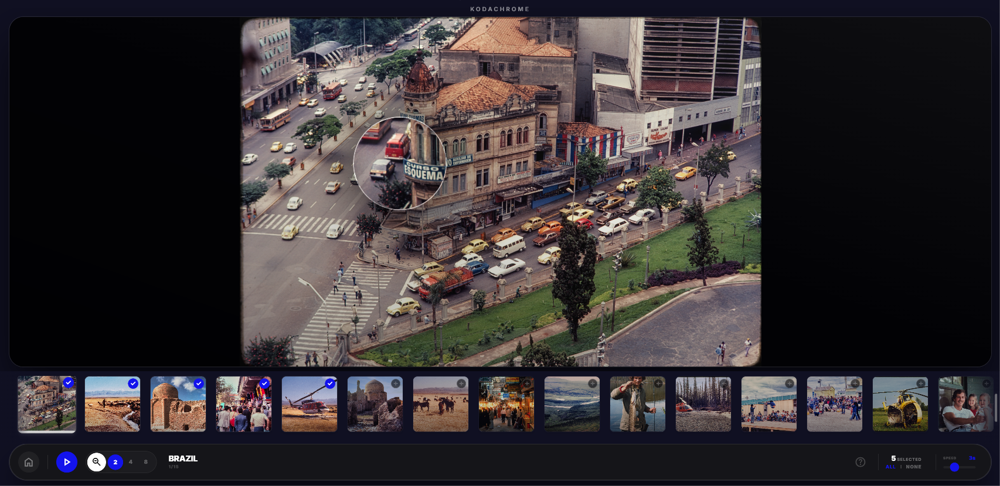

# Light Table — user guide

by Ryan Raz

## 1. What Light Table is

High Resolution image light table and slide show.

See it running: **My 1970s in Kodachrome** —
<https://rraz.ca/kodachrome/viewer/viewer.html>. That gallery is shown as a live
example of the viewer; it is not part of the package.

## 2. What it does

- Fully featured, including a magnifying loupe and the thumbnail strip.
- In slide show mode the image expands to take up the whole screen, apart from the
  controls.
- Self-contained: no database, no server code and nothing else to install. The
  folder you upload is the whole application.

## 3. The viewer in use



The magnifier is open at 2× in this capture: the lens follows the pointer across
the photograph, and the buttons beside it switch to 4× and 8×. The thumbnail
strip along the bottom is where photographs are chosen for the slide show.

*My 1970s in Kodachrome*

## 4. What you receive

One zip containing a single folder, named after the gallery. It includes a sample
gallery of eight colour slides, so the viewer can be checked before your own
photographs are added:

```
colours/
  viewer/
    viewer.html
    assets/
  colours/
    gallery.json
    01-red.png
    02-orange.png
    ...
    08-violet.png
```

- `viewer/` is the app. It is the same in every gallery and is not edited.
- the inner folder, with the same name, holds the images and `gallery.json`.
  The sample colour slides are replaced by your photographs.
- nothing else is required: no database, no server code, no installer.

The two folders must keep those names and that relationship. `viewer/` looks for
the gallery beside it.

## 5. Installing

Put the whole container folder on your website, unchanged. That is the whole
install: the folder is the viewer.

The address is:

```
https://yoursite.com/<container>/viewer/viewer.html
```

with `<container>` replaced by the folder name. The sample folder is `colours`, so
its address is:

```
https://yoursite.com/colours/viewer/viewer.html
```

The folder name is also the heading above the photos; hyphens become spaces, so
`lake-simcoe` is shown as **Lake Simcoe**. The folder can sit at the top level or
in a subfolder — only the address changes.

If your website accepts file uploads — FTP, a control panel File Manager, or the
upload in your host's dashboard — you can use the structure above exactly as it
is. If it only accepts images and text (a page builder such as Squarespace or
Wix), it cannot host the viewer, because there is nowhere to put `viewer.html`
and `assets/`.

You may want to keep each build as a dated zip (section 9), so the gallery can be
replaced or rolled back without rebuilding it.

**Check it:** open the address above. If the colour slides appear, it is
installed.

## 6. Opening it

```
https://yoursite.com/colours/viewer/viewer.html
https://yoursite.com/colours/viewer/viewer.html?gallery=/colours
```

Both open the same gallery. The `?gallery=` form is the explicit one and is the
safer choice when the viewer is embedded in another page or loaded from a
different folder; without it the viewer works out the gallery from its own
address. The live example in section 1 uses the short form.

## 7. Changing the gallery

There are two routes: send the folder back to be rebuilt, or edit it on the
server without any tools. Both touch the same two things:

- the images, in the inner folder — `colours/colours/` in the sample
- the list, `gallery.json`, beside them

A `gallery.json` entry looks like this:

```json
{
  "id": "01-first-photo",
  "url": "./01-first-photo.jpg",
  "title": "First photo"
}
```

`url` is the file name with `./` in front. `title` is what appears under the
photo.

### 7.1 Titles come from the file name

The simplest way to change a caption is to rename the file. `01-dawn.jpg` becomes
**01 dawn**; rename it to `Dawn over the lake.jpg` and the caption becomes
**Dawn over the lake**. Spaces, capitals and punctuation in the file name are
kept as typed.

If the title was set by hand in `gallery.json`, the file name must still match
`url`. Renaming the file breaks that link, and the entry is dropped on the next
rebuild.

### 7.2 Order

The order of the blocks in `gallery.json` is the order shown, so there are two
ways to arrange a gallery:

- **By rebuilding:** number the files `01-`, `02-`, `03-` and rebuild. Sorting is
  natural, so `2-` comes before `10-`.
- **By hand:** move the blocks in `gallery.json` into the order you want. The file
  names do not matter for this.

One trap: renaming a single file makes it a new entry, and a rebuild appends new
entries at the end. Rename all of them, or fix the order by hand afterwards.

### 7.3 Adding a photo

- **Rebuilding:** drop the file into the image folder and rebuild. It is added at
  the end, then can be moved.
- **By hand:** copy the last block in `gallery.json`, change `id`, `url` and
  `title` to the new file, and move the block to where it should appear. Upload
  the image as well.

### 7.4 Deleting a photo

Delete its block from `gallery.json` and delete the image. Do both: an entry
pointing at a missing file shows a broken photo, and an image with no entry never
appears.

### 7.5 More than one gallery

Each gallery is a self-contained folder with its own `viewer/`. They are updated
independently, and one gallery can be replaced without touching another.

## 8. Updating a live gallery

1. Keep a copy of the current folder before changing anything.
2. Replace the images and `gallery.json` (or replace the whole folder).
3. Open the page and hard-refresh (**Ctrl+F5**). Browsers cache `gallery.json`,
   so an old list can survive a normal reload.
4. If an image still shows the old version, its file name is the cache key —
   renaming the file forces the new one to load.

## 9. Versions and rollback

Name each build with a date, for example:

```
light-table-colours-v2026-10-28.zip
```

- Keep the current zip and the one before it.
- To roll back: delete the gallery folder on the server, upload the previous zip
  and extract it.
- Keep zips out of the public web root, or delete them after extracting. A zip
  sitting on the server can be downloaded by anyone who guesses the name, and it
  contains the whole gallery.

## 10. If something is wrong

| What you see | What it usually means |
|---|---|
| "Unable to load gallery" | `gallery.json` is not where the viewer expects it; check the two folder names |
| A blank frame | `assets/` was not uploaded beside `viewer.html` |
| Some photos missing | They are not listed in `gallery.json`, or the file name case differs from the entry |
| An old photo, or an old title | Browser cache — hard-refresh, or rename the file |
| Works on your computer, not online | Paths are relative; check that the inner folder was uploaded too |

## 11. Notes for maintaining gallery

- **Check how the site is updated before promising anything.** FTP, a control
  panel, or a page builder that cannot host files at all — section 5 covers what
  to look for.
- **Decide who rebuilds after new photos.** If the person who built the gallery
  does it, sections 7.2 to 7.4 shrink to "send the folder back", and the
  recipient never edits `gallery.json`.
- **Prefer one folder per gallery.** It is simpler for the recipient and lets one
  gallery be replaced without touching the others; the cost is that a viewer fix
  is uploaded once per gallery.
